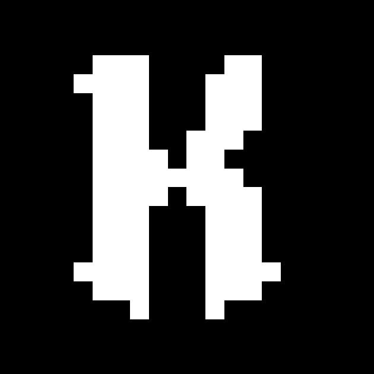

#  Kryn Inc.

> You may see im-proper/empty docs, and messy stuffs caz, this is still in improvements. And we are Lazy `:)`

### Developers Wearing Magician Masks!

---

## 🪄 About Us

Kryn Inc. is a developer community centered around **"Minecraft", "Anarchy", "Coding", "FUN", and "Experiments"**. We build / improve things, explore ideas, and contribute to anarchy communities, making the experience more fun and engaging for everyone.

## ✨ Our Work

| Project                                                                                                                                                                                | Description                                                                  |
| :------------------------------------------------------------------------------------------------------------------------------------------------------------------------------------- | :--------------------------------------------------------------------------- |
|  | A Bot API that helps your bot connect easily with the 6b6t Minecraft server. |
|     | idk All-in-one logging bot.                                                  |
|        | A bot that lets you teleport to spawn on 6b6t easily, active 24/7.           |

## 🎭 Become a Beyonder

Interested in Minecraft anarchy development? Ask about applying to become a Kryn developer in our public Discord. **Developer applications are open!**

## \*tip the Magicians!

**The magic asks for nothing.** What it earns simply keeps the servers alive, the bots at work, and the late nights of building well spent.

---

### 🎩 Every Developer Has a Trick.

_We bring the ideas. We write the code. We make the magic._

<a href="https://github.com/kryn-inc">Explore **Kryn Inc.** [↗]</a>

